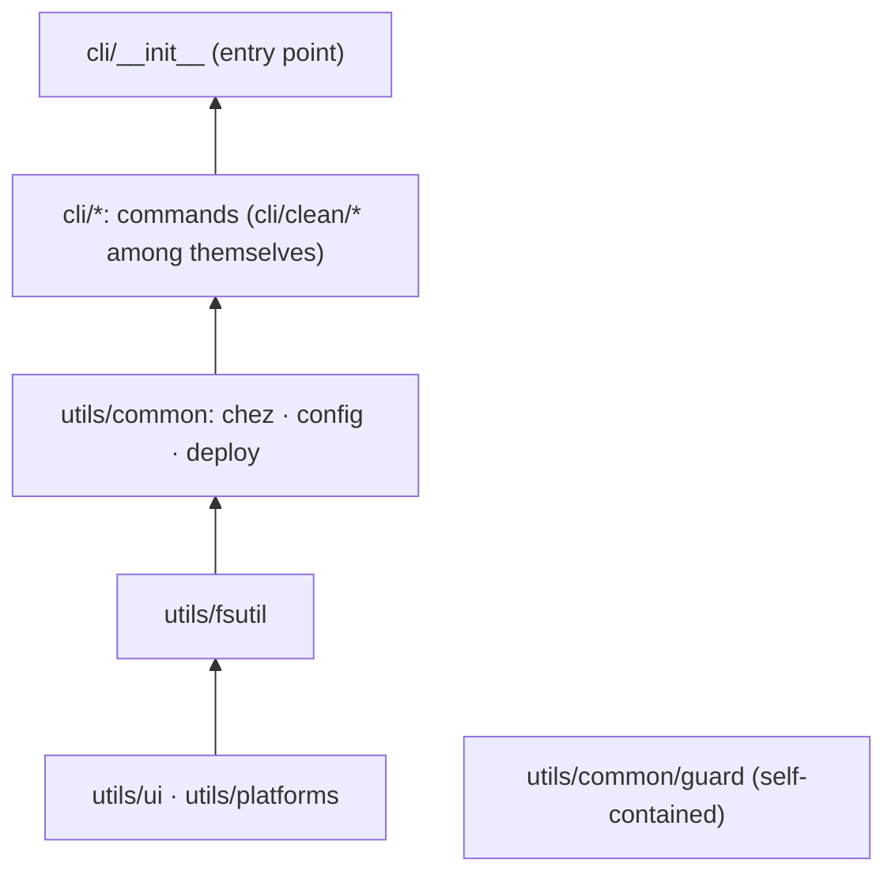

# Architecture

How the `dotfiles` tool is organized (since 0.3.0), which rules keep it that way, and where to put
new code. Commands and options are described in [reference.md](reference.md), branch usage in
[workflows.md](workflows.md). Chinese version: [architecture_zh-CN.md](architecture_zh-CN.md).

## 1. Constraints

The tool has to run on a freshly installed machine, before anything else is set up. That shapes
everything below:

- **Standard library only** at runtime. `uv` downloads the interpreter; nothing is fetched from PyPI
  (`dependencies = []`; pytest is a dev-only group).
- **Both platforms, one code base.** Platform differences stay in small, explicit places
  (`utils/platforms/`, the per-OS cleanup tables), never in separate branches of the repo.
- **chezmoi does the file work.** Every transfer between `~` and the source state goes through
  chezmoi; the tool decides *what* to pass, *whether* to encrypt and *whether* the result may be
  committed (see the README's design principles).
- **Preview by default.** Every modifying command shows what it would do and needs `--apply`
  (`backup` uses `-n` the other way round, but never pushes).

## 2. Layout

Two directories under the package: `cli/` holds the commands, `utils/` the building blocks they
share. At most three levels deep.

```
src/dotfiles/
├── __init__.py              version (read from the installed package metadata)
├── __main__.py              python -m dotfiles
├── cli/                     one module per command
│   ├── __init__.py          entry point (dotfiles.cli:main): argparse, lazy import of each command
│   ├── doctor.py            `doctor`          read-only environment detection
│   ├── restore.py           `restore`         post-reinstall recovery as idempotent steps
│   ├── apply.py             `apply`           repo -> ~ (preview, rehearsal, backup, deploy)
│   ├── backup.py            `backup` `status` `check`   ~ -> repo, plus the commit gate
│   ├── audit.py             `audit`           permissions of sensitive files
│   ├── etc.py               `system-restore`  Linux /etc via a second chezmoi instance (also used by backup)
│   ├── config.py            `config`          show / edit dotfiles.toml
│   └── clean/               `clean`
│       ├── __init__.py      scan / list / run / leftovers over the target tables
│       ├── base.py          engine types: Target, Ctx, Skip, path targets
│       ├── shared.py        toolchain targets for both platforms (uv, npm, cargo, ...)
│       ├── linux.py         Linux target table
│       └── windows.py       Windows target table
└── utils/
    ├── ui.py                terminal output, colors, Abort            ┐ generic: nothing
    ├── fsutil.py            link-safe sizes, scope-asserted Deleter   │ specific to this
    ├── platforms/           OS detection and OS-specific helpers      ┘ project
    │   ├── __init__.py      IS_WINDOWS/IS_LINUX, XDG/AppData paths, run(), processes, file locks
    │   ├── linux.py         /etc/os-release, Arch detection, /proc processes
    │   └── windows.py       PowerShell, tasklist, ACLs, scoop location
    └── common/              services of this project shared by two or more commands
        ├── chez.py          chezmoi wrapper: repo paths, config, age keys, platforms.toml
        ├── config.py        dotfiles.toml data layer: schema, loading, validation, editing
        ├── deploy.py        shared by apply and restore: pending changes, preview, rehearsal, apply
        └── guard/           commit/push checks; also run directly by pre-commit (section 4)
```

Where a module goes:

| Question | Goes to |
|---|---|
| Is it a command (has a `cmd_*` and a parser entry)? | `cli/` |
| Does only one command need it? | next to that command (e.g. `cli/clean/`) |
| Would it work unchanged in another project? | `utils/` (`ui`, `fsutil`) or `utils/platforms/` when it is OS-specific |
| Is it about this repo (chezmoi, dotfiles.toml, deployment, commit checks) and used by two or more commands? | `utils/common/` |

## 3. Layers



Arrows point from a layer to the layers built on it; a module may import from any layer below its
own. Rules (enforced by `tests/test_architecture.py`):

1. **`utils/` never imports `cli/`.**
2. **The generic utils (`ui`, `fsutil`, `platforms`) never import `utils/common/`.** They know
   nothing about chezmoi or this repo.
3. **Commands import other commands only inside functions** (e.g. `restore` calls `audit` and `etc`
   lazily). A broken or platform-specific command cannot break the others at import time, and the
   entry point stays fast. `cli/clean/*` may import each other at module level.
4. **`utils/common/guard/` imports only itself and the standard library**, and the package
   `__init__.py` files on its import path (`dotfiles`, `utils`, `utils/common`) import nothing.
   pre-commit runs it with the system Python, before uv or a venv exist (section 4).

## 4. guard: the extension interface

```
utils/common/guard/
├── __init__.py   public API (re-exports) and the subcommand overview
├── __main__.py   pre-commit entry: python src/dotfiles/utils/common/guard <subcommand>
├── base.py       Finding, FileContext, Check  — the extension interface
├── checks.py     rule data, built-in checks, the CHECKS registry, check_content()
├── paths.py      chezmoi source path -> deployment target
├── git.py        content sources: index, pushed commits, worktree
└── cli.py        staged / push / tree / scan / prune-stash, report format
```

A check is a pure function `check(ctx: FileContext) -> Iterable[Finding]`. `FileContext` gives it
the repo path, the bytes, the git mode, the deployment target (`ctx.target`) and the text for text
checks (`ctx.text`, `None` for ciphertext, binaries and large files). The built-in checks — `age`,
`policy` (must-encrypt), `secrets`, `home path` — are listed in `checks.CHECKS` in report order.

Adding a security check: write the function, append it to `CHECKS`, add tests. Because checks are
pure, the same check runs unchanged on the index (pre-commit), every commit about to be pushed
(pre-push) and the worktree (`dotfiles check`). A new *stage* (e.g. commit-msg) is the second
extension axis: a source in `git.py` and a subcommand in `cli.py`, reusing the same checks.

The interface is constrained on purpose:

- **Self-contained**: extensions follow rule 4 above.
- **Code only, never looser**: checks are registered in code and reviewed through a PR
  ([workflows.md](workflows.md) 2.2). There is no plugin directory, no entry-point discovery and no
  switch in `dotfiles.toml`: anything that a data file or a writable directory could change would
  itself be a way to switch the checks off.
- **No content in output**: a `Finding` has a level, a rule name and a location only, so no check can
  print the secret it found.

## 5. Where data lives

| What | Where | Written by |
|---|---|---|
| Backup/cleanup lists and tunables | `dotfiles.toml` (repo top) | you, or `dotfiles config add/remove/set` |
| Platform owner of every managed target | `home/.chezmoidata/platforms.toml` | `backup` (registers new targets), you |
| Dotfiles (source state) | `home/` (`.chezmoiroot`) | chezmoi (`add`, `re-add`, `edit`), via `backup` |
| /etc backup | `system/` | `backup` through a second chezmoi instance |
| Package manifests | `packages/` | `backup` |
| Commit-check rules (must-encrypt, secret patterns) | `utils/common/guard/checks.py` | code, on purpose (section 4) |
| chezmoi config | `~/.config/chezmoi/chezmoi.toml` | `chezmoi init` from `home/.chezmoi.toml.tmpl` |
| age private key | outside the repo (offline backup) | `restore` (key step) |
| Copies of overwritten files | `~/.local/state/dotfiles/pre-apply-*` | `apply`, `restore` |

`dotfiles.toml` sits outside `home/`, so chezmoi never deploys it. Its schema (keys, types,
descriptions, environment overrides) lives in `utils/common/config.py`; the file holds values only,
and `dotfiles check` rejects unknown keys and wrong types. Writes edit the file line by line, so
comments and ordering survive, and every write is re-parsed and validated before it replaces the
file.

## 6. Flows

```
backup   preflight -> re-add managed (tighten private_ files first) -> add candidates
         (dotfiles.toml track/secret minus ignore) -> /etc (cli/etc.py) -> packages
         -> gate (guard + platforms + config)
apply    resolve targets -> deploy.pending -> deploy.preview (encrypted: one line, never decrypted)
         -> [--apply] deploy.rehearse -> deploy.save_overwritten -> chezmoi apply
restore  key -> config -> dotfiles (deploy.deploy) -> system (cli/etc.py) -> packages -> externals
         -> ssh -> shell -> hooks -> verify (audit + gate)
clean    cli/clean/<os>.py table adjusted by dotfiles.toml [clean]
         -> measure / preview -> [--apply] Deleter (scope assertion on every path)
commit   pre-commit -> guard staged | pre-push -> guard push   (CHECKS on every file)
```

`apply` and the `dotfiles` step of `restore` share `utils/common/deploy.py`: the same rehearsal,
the same backup of overwritten files, the same chezmoi call. `restore` deploys everything, `apply`
can be limited to some targets and shows diffs first.

## 7. Extending

| To add | Do this |
|---|---|
| A path to back up | `dotfiles config add backup.<os>.track PATH` (or `secret`); no code |
| A candidate to silence | `dotfiles config add backup.<os>.ignore PATH` |
| A simple cache dir to clean | a `[[clean.paths]]` table in `dotfiles.toml`; the Deleter still checks its scope |
| A cleanup target with logic | a function returning `Target` in `cli/clean/<os>.py` (or `shared.py`), listed in that module's `targets()` |
| A tunable or list | a `Key` in `utils/common/config.SCHEMA` and the value in `dotfiles.toml`; `test_repo_file_is_valid_and_covers_the_schema` fails until both exist |
| A security check | a function in `utils/common/guard/checks.py` appended to `CHECKS`, plus tests (section 4) |
| An OS-specific helper | `utils/platforms/linux.py` or `windows.py`; keep it importable on every OS |
| A command | `cli/<name>.py` with a `cmd_*` function, a parser entry and a lazy import in `cli/__init__.py`; code shared with another command goes to `utils/common/` |
| A restore step | `check_*` / `run_*` functions and an entry in `restore.STEPS`; detection must be idempotent |

## 8. Changes in 0.3.0

| Before | Now |
|---|---|
| `cli.py` | `cli/__init__.py` (entry point unchanged: `dotfiles.cli:main`) |
| `doctor.py`, `restore.py`, `backup.py` (incl. audit), `system_etc.py` | `cli/doctor.py`, `cli/restore.py`, `cli/backup.py`, `cli/audit.py`, `cli/etc.py` |
| `clean/__init__.py`, `clean/common.py`, `linux.py`, `windows.py` | `cli/clean/__init__.py` + `base.py`, `shared.py`, `linux.py`, `windows.py` |
| `sysinfo.py` | `utils/platforms/` (OS-specific parts in `linux.py` / `windows.py`; `scoop_dir` and the ACL helpers moved there from clean and audit) |
| `chez.py` | `utils/common/chez.py` |
| `guard.py` (one file) | `utils/common/guard/` (package with the check registry); pre-commit runs `python src/dotfiles/utils/common/guard` |
| deploy logic inside `restore.py` | `utils/common/deploy.py`, shared with the new `cli/apply.py` |
| lists in code; thresholds from env vars | `dotfiles.toml` + `utils/common/config.py` (env vars still override thresholds) |
| `__version__` hardcoded | read from package metadata (`pyproject.toml` is the only source) |

New: `dotfiles apply`, `dotfiles config`, `backup.<os>.ignore`, `[clean] disabled/opt`,
`[[clean.paths]]`, the guard check registry, and the layering tests.
