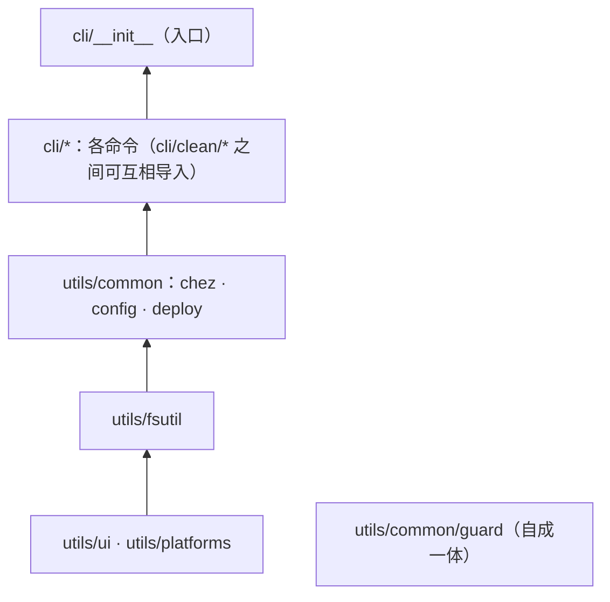

# 架构

`dotfiles` 工具（0.3.0 起）的组织方式、维持这种组织的规则，以及新代码该放在哪里。命令与选项见
[reference_zh-CN.md](reference_zh-CN.md)，分支用法见 [workflows_zh-CN.md](workflows_zh-CN.md)。
英文版：[architecture.md](architecture.md)。

## 1. 约束

这个工具要在刚装好的机器上、其他东西都还没配置时运行，下面的所有设计都由此而来：

- **运行时只用标准库。** `uv` 只负责下载解释器，不从 PyPI 获取任何东西（`dependencies = []`；
  pytest 只在 dev 依赖组里）。
- **两个平台，一份代码。** 平台差异集中在少数明确的地方（`utils/platforms/`、各平台的清理目标表），
  不靠仓库分支区分。
- **文件读写交给 chezmoi。** `~` 与源状态之间的所有转换都经过 chezmoi；工具只决定交给它*哪些*文件、
  *是否*加密、结果*能否*提交（见 README 的设计原则）。
- **默认只预览。** 所有修改性命令先展示将要做什么，加 `--apply` 才执行（`backup` 反过来用 `-n`
  预览，但从不推送）。

## 2. 目录结构

包下分两个目录：`cli/` 放命令，`utils/` 放命令共用的基础部件。最深三层。

```
src/dotfiles/
├── __init__.py              版本号（从已安装包的元数据读取）
├── __main__.py              python -m dotfiles
├── cli/                     每个命令一个模块
│   ├── __init__.py          入口（dotfiles.cli:main）：argparse，各命令延迟导入
│   ├── doctor.py            `doctor`          只读的环境检测
│   ├── restore.py           `restore`         重装后恢复，由一组幂等步骤组成
│   ├── apply.py             `apply`           仓库 -> ~（预览、预演、备份、部署）
│   ├── backup.py            `backup` `status` `check`   ~ -> 仓库，以及提交前的安全检查
│   ├── audit.py             `audit`           敏感文件权限
│   ├── etc.py               `system-restore`  Linux /etc，通过第二个 chezmoi 实例（backup 也会用到）
│   ├── config.py            `config`          查看 / 编辑 dotfiles.toml
│   └── clean/               `clean`
│       ├── __init__.py      基于目标表的 scan / list / run / leftovers
│       ├── base.py          引擎类型：Target、Ctx、Skip、路径目标
│       ├── shared.py        两端共用的工具链目标（uv、npm、cargo 等）
│       ├── linux.py         Linux 目标表
│       └── windows.py       Windows 目标表
└── utils/
    ├── ui.py                终端输出、颜色、Abort                ┐ 通用：与本项目
    ├── fsutil.py            不跟随链接的体积统计、带范围断言的 Deleter │ 无关
    ├── platforms/           平台检测与平台专属的辅助函数          ┘
    │   ├── __init__.py      IS_WINDOWS/IS_LINUX、XDG/AppData 路径、run()、进程、文件锁
    │   ├── linux.py         /etc/os-release、Arch 检测、/proc 进程列表
    │   └── windows.py       PowerShell、tasklist、ACL、scoop 位置
    └── common/              本项目的共享服务，被两个及以上命令使用
        ├── chez.py          chezmoi 封装：仓库路径、配置、age 密钥、platforms.toml
        ├── config.py        dotfiles.toml 数据层：schema、加载、校验、编辑
        ├── deploy.py        apply 与 restore 共用：待部署变更、预览、预演、部署
        └── guard/           提交 / 推送检查；也由 pre-commit 直接执行（第 4 节）
```

一个模块放在哪里：

| 判断 | 放到 |
|---|---|
| 它是一个命令（有 `cmd_*` 和解析器条目）吗？ | `cli/` |
| 只有一个命令需要它？ | 和那个命令放在一起（例如 `cli/clean/`） |
| 原样拿到别的项目里也能用？ | `utils/`（`ui`、`fsutil`）；与操作系统相关的放 `utils/platforms/` |
| 与本仓库有关（chezmoi、dotfiles.toml、部署、提交检查），且被两个及以上命令使用？ | `utils/common/` |

## 3. 分层



箭头从一层指向建立在它之上的层；模块可以导入它下方任意一层。规则（由 `tests/test_architecture.py`
检查）：

1. **`utils/` 从不导入 `cli/`。**
2. **通用部件（`ui`、`fsutil`、`platforms`）从不导入 `utils/common/`。** 它们对 chezmoi 和本仓库一无所知。
3. **命令之间只在函数内部互相导入**（例如 `restore` 延迟调用 `audit` 和 `etc`）。某个命令损坏或只适用
   于某个平台时，不会在导入阶段连累其他命令，入口也保持轻快。`cli/clean/*` 之间可以在模块级互相导入。
4. **`utils/common/guard/` 只导入自身和标准库**，它导入路径上的包 `__init__.py`（`dotfiles`、`utils`、
   `utils/common`）也不导入任何东西。pre-commit 用系统 Python 运行它，那时 uv 和 venv 可能都还不存在（第 4 节）。

## 4. guard：扩展接口

```
utils/common/guard/
├── __init__.py   公开 API（重新导出）与子命令概览
├── __main__.py   pre-commit 入口：python src/dotfiles/utils/common/guard <子命令>
├── base.py       Finding、FileContext、Check —— 扩展接口
├── checks.py     规则数据、内置检查、CHECKS 注册表、check_content()
├── paths.py      chezmoi 源路径 -> 部署目标
├── git.py        内容来源：暂存区、待推送的提交、工作区
└── cli.py        staged / push / tree / scan / prune-stash，输出格式
```

检查是一个纯函数 `check(ctx: FileContext) -> Iterable[Finding]`。`FileContext` 提供仓库内路径、文件字节、
git 模式、部署目标（`ctx.target`）以及供文本检查使用的内容（`ctx.text`；密文、二进制和大文件为 `None`）。
内置检查 `age`、`policy`（必须加密）、`secrets`、`home path` 按输出顺序列在 `checks.CHECKS` 中。

新增一项安全检查：写一个函数，追加到 `CHECKS`，补上测试。由于检查是纯函数，同一个检查无需改动就能用于
暂存区（pre-commit）、每个待推送的提交（pre-push）和工作区（`dotfiles check`）。新的*阶段*（例如
commit-msg）是第二个扩展维度：在 `git.py` 中加一个来源、在 `cli.py` 中加一个子命令，复用同一组检查。

这个接口有意加了约束：

- **自成一体**：扩展遵守上面第 3 节的规则 4。
- **只能写在代码里，只能更严**：检查在代码中注册，并通过 PR 审查（[workflows_zh-CN.md](workflows_zh-CN.md)
  2.2）。没有插件目录、没有 entry point 自动发现，`dotfiles.toml` 中也没有开关：凡是数据文件或可写目录能改变
  的东西，本身就成了关闭检查的途径。
- **输出不含内容**：`Finding` 只有级别、规则名和位置，任何检查都无法把它发现的密钥打印出来。

## 5. 数据放在哪里

| 内容 | 位置 | 由谁写入 |
|---|---|---|
| 备份 / 清理清单与阈值 | `dotfiles.toml`（仓库顶层） | 你，或 `dotfiles config add/remove/set` |
| 每个托管目标的平台归属 | `home/.chezmoidata/platforms.toml` | `backup`（登记新目标）、你 |
| dotfiles（源状态） | `home/`（`.chezmoiroot`） | chezmoi（`add`、`re-add`、`edit`），经由 `backup` |
| /etc 备份 | `system/` | `backup`，通过第二个 chezmoi 实例 |
| 软件包清单 | `packages/` | `backup` |
| 提交检查规则（必须加密的类别、密钥特征） | `utils/common/guard/checks.py` | 代码，有意为之（第 4 节） |
| chezmoi 配置 | `~/.config/chezmoi/chezmoi.toml` | `chezmoi init`，由 `home/.chezmoi.toml.tmpl` 生成 |
| age 私钥 | 仓库之外（离线备份） | `restore`（key 步骤） |
| 被覆盖文件的副本 | `~/.local/state/dotfiles/pre-apply-*` | `apply`、`restore` |

`dotfiles.toml` 在 `home/` 之外，chezmoi 永远不会部署它。它的 schema（键、类型、说明、可覆盖的环境变量）
在 `utils/common/config.py` 中，文件里只放值；`dotfiles check` 会拒绝未知的键和错误的类型。写入是逐行编辑，
注释和顺序都会保留；每次写入都先重新解析并校验，通过后才替换原文件。

## 6. 流程

```
backup   预检 -> re-add 已托管文件（先收紧 private_ 文件的权限）-> 加入候选
         （dotfiles.toml 的 track/secret 减去 ignore）-> /etc（cli/etc.py）-> 软件包
         -> 安全检查（guard + 平台归属 + 配置）
apply    解析目标 -> deploy.pending -> deploy.preview（加密目标只显示一行，从不解密）
         -> [--apply] deploy.rehearse -> deploy.save_overwritten -> chezmoi apply
restore  key -> config -> dotfiles（deploy.deploy）-> system（cli/etc.py）-> packages -> externals
         -> ssh -> shell -> hooks -> verify（audit + 安全检查）
clean    cli/clean/<os>.py 目标表按 dotfiles.toml [clean] 调整
         -> 统计 / 预览 -> [--apply] Deleter（每个路径都做范围断言）
commit   pre-commit -> guard staged | pre-push -> guard push   （对每个文件运行 CHECKS）
```

`apply` 与 `restore` 的 `dotfiles` 步骤共用 `utils/common/deploy.py`：同样的预演、同样的覆盖前备份、
同样的 chezmoi 调用。`restore` 部署全部内容；`apply` 可以只部署部分目标，并先展示 diff。

## 7. 扩展

| 要加入 | 做法 |
|---|---|
| 一个要备份的路径 | `dotfiles config add backup.<os>.track 路径`（或 `secret`），不需要改代码 |
| 一个不想再被提示的候选 | `dotfiles config add backup.<os>.ignore 路径` |
| 一个简单的缓存目录清理 | 在 `dotfiles.toml` 中加一个 `[[clean.paths]]` 表；Deleter 仍会检查它的范围 |
| 一个带逻辑的清理目标 | 在 `cli/clean/<os>.py`（或 `shared.py`）中写一个返回 `Target` 的函数，并列入该模块的 `targets()` |
| 一个阈值或清单 | 在 `utils/common/config.SCHEMA` 中加一个 `Key`，并在 `dotfiles.toml` 中写入值；两者缺一，`test_repo_file_is_valid_and_covers_the_schema` 就会失败 |
| 一项安全检查 | 在 `utils/common/guard/checks.py` 中写一个函数并追加到 `CHECKS`，补上测试（第 4 节） |
| 一个平台专属的辅助函数 | `utils/platforms/linux.py` 或 `windows.py`；保持在任何系统上都能导入 |
| 一个命令 | `cli/<名称>.py`，含 `cmd_*` 函数，并在 `cli/__init__.py` 中加解析器条目和延迟导入；与其他命令共用的代码放进 `utils/common/` |
| 一个 restore 步骤 | 写 `check_*` / `run_*` 函数并加入 `restore.STEPS`；检测必须幂等 |

## 8. 0.3.0 的变化

| 之前 | 现在 |
|---|---|
| `cli.py` | `cli/__init__.py`（入口不变：`dotfiles.cli:main`） |
| `doctor.py`、`restore.py`、`backup.py`（含权限审计）、`system_etc.py` | `cli/doctor.py`、`cli/restore.py`、`cli/backup.py`、`cli/audit.py`、`cli/etc.py` |
| `clean/__init__.py`、`clean/common.py`、`linux.py`、`windows.py` | `cli/clean/__init__.py` + `base.py`、`shared.py`、`linux.py`、`windows.py` |
| `sysinfo.py` | `utils/platforms/`（平台专属部分在 `linux.py` / `windows.py`；`scoop_dir` 和 ACL 辅助函数从 clean、audit 移入） |
| `chez.py` | `utils/common/chez.py` |
| `guard.py`（单文件） | `utils/common/guard/`（带检查注册表的包）；pre-commit 运行 `python src/dotfiles/utils/common/guard` |
| `restore.py` 中的部署逻辑 | `utils/common/deploy.py`，与新的 `cli/apply.py` 共用 |
| 写死在代码中的清单；阈值来自环境变量 | `dotfiles.toml` + `utils/common/config.py`（环境变量仍可覆盖阈值） |
| 写死的 `__version__` | 从包元数据读取（`pyproject.toml` 是唯一来源） |

新增：`dotfiles apply`、`dotfiles config`、`backup.<os>.ignore`、`[clean] disabled/opt`、
`[[clean.paths]]`、guard 检查注册表，以及分层测试。
